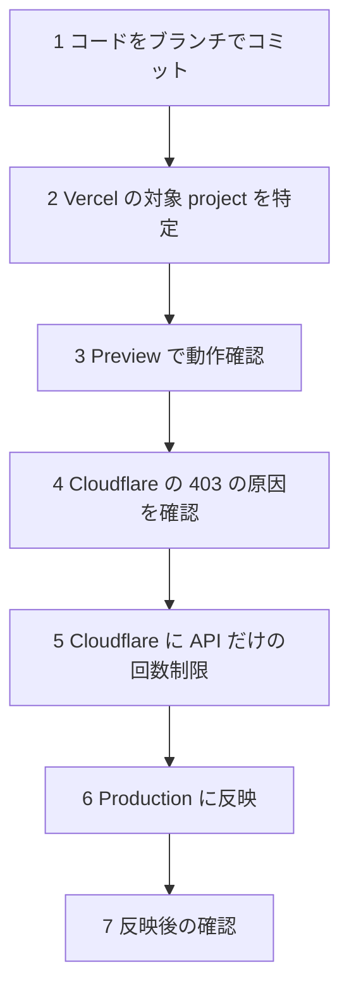

# AXEON 本番設定手順（Vercel / Cloudflare）

- 作成日: 2026-11-10
- 対象: https://www.axeon.jp/ （リポジトリ `ideal-tomy/rinopro-site`）
- 関連: [改善PLAN.md](改善PLAN.md)

コード側の対策は済んでいます（未コミット）。サイトを公開したまま守るには、このあと人が管理画面で行う作業が残っています。この文書はその手順です。

秘密の値（API キー、トークン）は、この文書にもチャットにも貼らないでください。確認するのは「項目名があるか」「どの環境に入っているか」だけです。

画面の名前やメニューの位置は、Vercel / Cloudflare の更新で変わることがあります。見つからないときは、各節の「探すもの」を手がかりにしてください。

## 0. いまの状態

| 項目 | 状態 |
|---|---|
| コード | 対策済み。`main` ブランチに未コミットのまま |
| 本番サイト | 監査時点で Cloudflare が 403 を返している（一般の閲覧者も見られない可能性がある） |
| 本番の Vercel project | 未特定 |
| 問い合わせの自動返信 | 既定のまま送る設定 |

公開を保つ、とは次の状態にすることです。

- ページは誰でも見られる。Cloudflare でサイト全体を拒否しない。
- 問い合わせと AI を呼ぶ API だけ、短時間の大量送信を Cloudflare で止める。
- 悪用が起きたら、自動返信だけを止められる（管理者への通知は届き続ける）。

## 1. コード側で済んだこと

| ID | 内容 | 利用者から見た変化 |
|---|---|---|
| A-04 | AI API の失敗時に、内部のエラー文ではなく固定文を返す。ストリーム途中の失敗も同じ | 失敗時の文言が「処理に失敗しました。時間をおいて再度お試しください。」になる |
| A-02 | 問い合わせのログから氏名・メール・会社名・本文を外した。AI のエラーログからプロンプト本文を外した | なし |
| A-01 | 管理者通知を先に送り、成功したときだけ自動返信を送る。自動返信だけ失敗しても再送させない。氏名・会社名・メールの改行を拒否。`CONTACT_CUSTOMER_AUTOREPLY=false` で自動返信だけ止められる | 通常はなし |
| A-03 | AI API の入力に件数・文字数・全体サイズの上限。`system` 役割のメッセージを拒否 | 通常の利用ではなし。極端に長い入力は 400 |
| A-06 | `next` 16.2.0 → 16.4.6、`sharp` 0.34.5 → 0.35.5 | なし（ビルドと画像表示を確認済み） |
| — | 回数制限を API ごとに別のカウントにした | 問い合わせとチャットで回数を取り合わない |

確認したこと: `npm run build` 成功、型チェック成功、変更ファイルの lint 成功、`npm run verify:contact-mail` 成功、ローカルでの問い合わせ送信（メールは実際には送らない開発モード）、各 API の上限超過が 400 になること、画像 20 枚の表示。

まだ残っていること: Turnstile を載せたコードのデプロイ、全サーバー共通の回数制限、DMARC の強化。回数制限の共有と DMARC は、管理画面の作業か別の承認が必要です。

## 2. 反映の順番

`main` へ直接コミットしないでください。ブランチ（例: `fix/security-public-hardening`）でコミットし、Preview で確認してから本番へ入れます。

## 3. Vercel

### 3-1. 対象 project を特定する（読むだけ）

探すもの: `axeon.jp` が登録されている project。

1. Vercel のダッシュボードで、チーム（左上の切り替え）を順に見ます。
2. 各 project の Settings → Domains を開き、`axeon.jp` か `www.axeon.jp` がある project を探します。
3. 見つかった project 名と、チーム名を控えます。

見つからない場合は、別のアカウントかチームで管理されています。持ち主に確認してください。この project が特定できるまで、本番反映は進めません。

### 3-2. 本番の commit を確認する（読むだけ）

1. project の Deployments を開きます。
2. 「Production」と付いている最新のデプロイを開き、commit の番号（7 桁ほど）を控えます。
3. 監査時点の `62c55fa` と同じか比べます。違う場合は、本番は別のコードで動いています。その commit を教えてください。差分を確認します。
4. Settings → Git で、Production Branch が何か（通常は `main`）を控えます。

### 3-3. 環境変数を確認する（値は見ない）

Settings → Environment Variables を開き、次の項目名があるかと、どの環境（Production / Preview / Development）に入っているかだけを見ます。

| 項目名 | 必要な環境 | 確認すること |
|---|---|---|
| `RESEND_API_KEY` | Production | Preview に本番と同じキーが入っていないか。Preview にも入っていると、確認用の URL から本物のメールが出る |
| `CONTACT_FROM_EMAIL` | Production | 送信元のドメインが `axeon.jp` か（4-3 の DKIM 確認に使う） |
| `CONTACT_ADMIN_EMAIL` | Production | 管理者の受信先 |
| `GOOGLE_GENERATIVE_AI_API_KEY` | Production | Preview に入っているなら、Preview の URL が公開状態になっていないか（3-5） |
| `SANITY_API_TOKEN` | 本番には不要 | 書き込み用トークン。Production / Preview に入っているなら外してよいか確認する |
| `CONTACT_CUSTOMER_AUTOREPLY` | 通常は入れない | 自動返信を止めたいときだけ `false` を入れる（3-4） |

### 3-4. 自動返信だけを止めるとき（緊急時）

迷惑メールの踏み台にされた、Resend の送信数が急に増えた、などのときに使います。管理者への通知はこのあとも届きます。フォームの画面と完了メッセージは変わりません。

1. Settings → Environment Variables で、`CONTACT_CUSTOMER_AUTOREPLY` を値 `false`、環境 Production で追加します。
2. 環境変数は、追加しただけでは反映されません。Deployments の最新 Production の「…」メニューから Redeploy を実行します。
3. 戻すときは、この項目を削除して、もう一度 Redeploy します。

### 3-5. Preview の URL を守る

Preview（確認用）の URL は、そのままだと誰でも開けることがあります。そこから問い合わせや AI API を叩かれると、本番と同じ費用が出ます。

探すもの: Settings → Deployment Protection。

- Preview に Vercel Authentication（ログインした人だけが見られる）が有効になっているか確認します。
- 無効なら、有効にしてよいか判断してください。本番ドメイン（`axeon.jp`）には影響しません。

### 3-6. ログの閲覧者と保持期間

- Settings → Members（チームの設定）で、ログを見られる人を確認します。
- ログの保持期間はプランで決まります。今回のコードで、問い合わせの個人情報はログに出なくなりました。反映前の古いログには氏名・メール・会社名が残っている可能性があります。

### 3-7. 反映と戻し方

- 反映: ブランチを Production Branch へマージすると、自動で Production にデプロイされます（Git 連携が有効な場合）。
- 戻す: Deployments で、ひとつ前の Production デプロイを開き、Promote to Production（または Instant Rollback）を実行します。コードを戻さなくても、表示中のサイトは直前の状態に戻ります。

## 4. Cloudflare

### 4-1. 403 の原因を確認する（読むだけ）

探すもの: `axeon.jp` のゾーン → Security → Events（セキュリティイベント）。

1. 期間を直近にして、`www.axeon.jp` への「Block」や「Managed Challenge」を探します。
2. どのルールが止めているかを見ます。主な候補は次のとおりです。

| 原因の候補 | 画面の場所の目安 | 公開を保つための考え方 |
|---|---|---|
| WAF のカスタムルール | Security → WAF → Custom rules | サイト全体を対象にしたルールなら、対象を絞るか、Block を Managed Challenge に変える |
| Bot Fight Mode | Security → Bots | 一般の閲覧者まで止めていないか確認する。止めているなら一度オフにして様子を見る |
| Under Attack Mode | Security → Settings | 常時オンにしない |
| 国・IP の制限 | WAF のルール、または IP Access Rules | 日本からの閲覧が止まっていないか確認する |
| Cloudflare Access | Zero Trust → Access → Applications | `axeon.jp` 全体が Access の対象なら、公開ページは対象から外す |

調査のために一般の閲覧者のふりをして試すのはかまいません。ルールを外すかどうかは、上の表で原因が分かってから決めてください。原因が分からないまま全部オフにはしないでください。

### 4-2. API だけに回数制限を掛ける

アプリ内の回数制限は、サーバーが複数台に分かれると台ごとに数えてしまいます。Cloudflare を通しているなら、Cloudflare は閲覧者ごとの本当の接続元で数えられます。全体の上限はこちらで掛けます。

探すもの: Security → WAF → Rate limiting rules。

推奨する設定の例です。数値は、実際の利用状況を見て調整してください。

| ルール | 対象 | 上限の例 | 超えたとき |
|---|---|---|---|
| 問い合わせ | パスが `/api/contact`、メソッドが POST | 同じ IP から 1 分に 5 回 | 10 分ブロック |
| AI API | パスが `/api/chat`、`/api/demo/run`、`/api/estimate-detailed`、`/api/experience/knowledge-bot`、`/api/inquiry-brief` | 同じ IP から 1 分に 20 回 | 10 分ブロック |

注意点:

- プランによって、作れるルール数と数える期間が違います。無料プランではルールが 1 つまでのことがあります。その場合は問い合わせのルールを優先し、対象パスに AI API も含めてください。
- ページ（`/`、`/contact` など）は対象にしないでください。閲覧者が止まります。
- 設定後、普通に問い合わせを 1 回送って止められないことを確認します。

### 4-3. SSL の設定を確認する（読むだけ）

SSL/TLS → Overview の暗号化モードが Full (strict) か確認します。Flexible の場合、Cloudflare と Vercel の間が暗号化されていません。変えるときは、変更前のモードを控えてから行ってください。

### 4-4. Turnstile（コード側は入っている）

問い合わせを送るたびに、Cloudflare Turnstile で確認します。通常の訪問ではチェック欄は出ません。Cloudflare が追加の確認を求めたときだけ欄が出ます。確認が終わるまで、送信ボタンは押せません。

Vercel には、次の名前で登録します。値はこの文書に書きません。

- `NEXT_PUBLIC_TURNSTILE_SITE_KEY`（Production と Preview）
- `TURNSTILE_SECRET_KEY`（Production と Preview）

`TURNSTILE_ALLOWED_HOSTS` は未設定で構いません。未設定のときは `axeon.jp` と `www.axeon.jp` だけを許可します。

Cloudflare のウィジェット側のホスト名に、`axeon.jp` と `www.axeon.jp` を入れてください。プレビューの URL で問い合わせを試すときは、そのプレビューのホスト名もウィジェットに追加します。手元で試すときは `localhost` も追加します。

秘密鍵が入っているのに、ウィジェットのホスト名が違うと、送信ボタンが押せないか、送信が拒否されます。このコードが本番に載るまでは、Vercel にキーがあってもフォームはまだ確認しません。

## 5. メール認証（今回は確認だけ）

DNS は Cloudflare にあります。公開 DNS では、SPF が 1 レコード、DMARC が `p=none`（監視のみ）でした。

いきなり `p=quarantine` や `p=reject` にすると、正規のメールまで迷惑メール扱いになるおそれがあります。次の順番で進めます。

1. Resend の Domains で、`CONTACT_FROM_EMAIL` のドメインが Verified か、DKIM が有効かを確認します。
2. Google Workspace など、ほかに `axeon.jp` から送っているサービスの DKIM も確認します。
3. すべて揃うまで、DMARC は `p=none` のままにします。
4. 揃ったら、レポートの受信先（`rua=`）を足して数週間様子を見ます。
5. 正規のメールがすべて認証を通っていれば、`p=quarantine` を検討します。

DNS の変更は、変更前の値を控えてから行ってください。

## 6. 反映後の確認

本番に反映したら、次を確認します。試験の送信は、あらかじめ決めた自社のアドレスだけで行ってください。

| 確認 | 期待する結果 |
|---|---|
| トップ、ご支援内容、会社紹介、体験デモ、問い合わせの各ページ | 403 にならず表示される。画像も出る |
| 問い合わせを 1 件送る | 画面に「送信しました。2営業日以内にご返信します。」。管理者宛には相談内容が届く。自動返信は受付の定型文だけで、入力した本文は載らない |
| Vercel のログ | `[Contact] inbound` の行に氏名・メールアドレス・会社名が出ていない |
| 同じ問い合わせを短時間に何度も送らない | 回数制限の確認は大量送信で行わない。Cloudflare の Events で 4-2 のルールが動いているかを見る |

うまくいかないときは、3-7 の手順で直前のデプロイに戻してから、状況を教えてください。

## 7. 依存関係で残っている指摘

`npm audit` には、更新後も critical 2 件、high 30 件が残っています。critical の 2 件は、どちらもサイトの実行経路ではありません。

| パッケージ | 入っている場所 | 判断 |
|---|---|---|
| `tar` | Sanity のエクスポート用 CLI（`sanity` → `@sanity/export`） | 開発者が手元で使う道具。Web サイトの処理では動かない |
| `proxy-addr` | `shadcn` の CLI に入っている MCP SDK（express） | 開発時の部品追加ツール。Web サイトの処理では動かない |

残りの high も、多くは Sanity の CLI や開発ツール経由です。`next-sanity` と `sanity` はメジャー更新が必要なため、別の作業として扱います。`npm audit fix --force` は実行しないでください。Studio が動かなくなるおそれがあります。

## 8. 判断が必要なこと

1. Vercel の project を管理しているアカウントは誰か（3-1）
2. 403 の原因になっているルールを、どこまで緩めるか（4-1）
3. Preview を Vercel Authentication で守るか（3-5）
4. Turnstile のウィジェットに `axeon.jp` と `www.axeon.jp` が入っているか（4-4）
